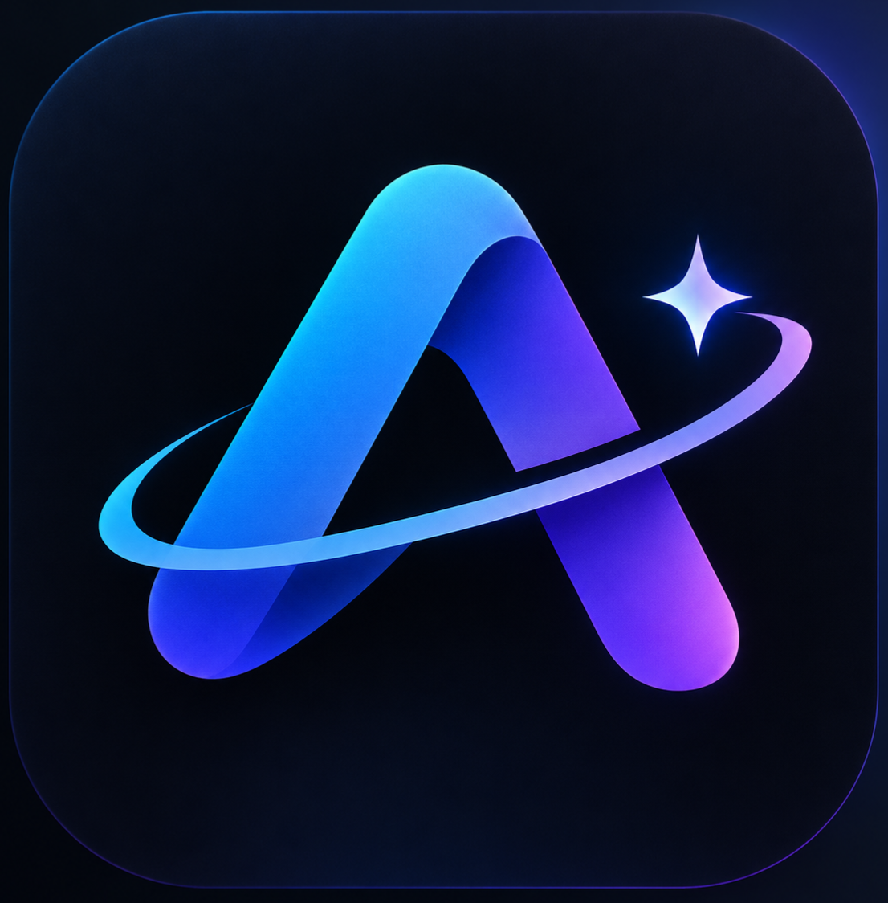

<p align="center">
  
</p>

<h1 align="center">Aura AI</h1>

<p align="center">
  <strong>Local-first AI chat, image generation, and model serving — built with Flutter.</strong>
</p>

<p align="center">
  
  
  
  
</p>

> **Current release:** `1.0.5+5`<br>
> **Primary target:** Android 9+ (API 28), arm64 release build

Aura AI is an Android-first Flutter application for running language models and Stable Diffusion locally on a phone, with optional cloud APIs when you need more power. It combines a model manager, streaming chat, image generation, local inference diagnostics, and an OpenAI-compatible local server in one app.

> **Platform note:** Android is the primary release target for this version. The repository still contains the iOS and Web scaffolding from the cross-platform project, but the native LiteRT-LM and Stable Diffusion paths documented here are Android builds.

---

## Features

- **On-device text generation** — run GGUF models through `llama.cpp` on ARM64 devices, with CPU inference and Vulkan layer offload when the GPU/driver supports it.
- **LiteRT-LM** — run `.litertlm` bundles through the LiteRT-LM 0.18.1 runtime, with CPU/GPU selection and optional vision support on compatible bundles.
- **Local image generation** — run Stable Diffusion 1.5 `.safetensors` models through `stable-diffusion.cpp`; CPU is the default, while Vulkan/OpenCL GPU inference is experimental.
- **Cloud when you want it** — switch to OpenRouter, OpenAI, DeepSeek, Google Gemini, NVIDIA NIM, or a custom OpenAI-compatible endpoint without leaving the chat.
- **OpenAI-compatible local server** — expose the currently loaded local model on port `8080` for other apps and tools on the same network.
- **Chat workspace** — streaming responses, Markdown and code rendering, a collapsible reasoning view, stop generation, tokens/second, persistent sessions, and per-chat history.
- **Attachments** — images for cloud and LiteRT vision models, PDF/DOCX/text/code extraction, and microphone speech-to-text.
- **Model manager** — curated downloads, local file import, custom model URLs, download progress, model validation, and storage cleanup.
- **Device-aware defaults** — RAM-based context/token presets, GGUF Vulkan detection, and a model-size safety guard for local image GPU inference.
- **Local-first data** — chats, settings, and API keys stay in on-device Hive storage. Chat content is only sent to a cloud provider when cloud inference is active.

---

## Inference paths

| Runtime | File type | Acceleration | Support in this build |
| --- | --- | --- | --- |
| `llama.cpp` / `llama_flutter_android` | `.gguf` | CPU; Vulkan GPU-layer offload when available | Text chat |
| LiteRT-LM 0.18.1 / `flutter_litert_lm` | `.litertlm` | CPU or GPU (OpenCL where supported) | Text chat; vision on compatible bundles |
| `stable-diffusion.cpp` / `sd_flutter_android` | `.safetensors` (SD 1.5) | CPU by default; Vulkan/OpenCL experimental | Image generation |
| Cloud APIs | Provider model IDs | Remote | Text; image input on supported models |

### Model catalog

The built-in catalog contains a mix of LiteRT-LM, GGUF, and Stable Diffusion 1.5 models. Downloads come from Hugging Face, and each model keeps its own license. You can also import a model from storage or add a direct download URL.

Useful examples from the current catalog:

- **LiteRT-LM:** Qwen 2.5 1.5B Instruct, DeepSeek R1 Distill Qwen 1.5B, Gemma 4 E2B/E4B Instruct
- **GGUF:** Qwen 2.5 3B, Llama 3.2 1B/3B, Phi-3.5 Mini, Gemma 2 2B, SmolLM2 1.7B, Dolphin 3.0
- **Image generation:** DreamShaper 8 LCM, CyberRealistic V8, Realistic Vision V5.1, AbsoluteReality, AnyLoRA

> **GGUF vision note:** this build's GGUF runtime is text-only. It does not load an `mmproj` projector. For image understanding, use a compatible LiteRT-LM vision bundle.

---

## What changed in 1.0.5

- Upgraded the LiteRT-LM Android runtime to **0.18.1** and aligned the build with **Kotlin 2.4.0**.
- Isolated LiteRT cache under `litert_cache_v0181` so GPU artifacts from older runtimes are not reused.
- Fixed native stream lifecycle issues with unique stream IDs, pending-stream cancellation, and generation counters.
- Reset the native KV/context when starting a fresh chat or switching conversations, so old turns do not leak into new ones.
- Added reasoning-token keepalive and a longer watchdog for DeepSeek-style `thought` output.
- Added automatic **text-only fallback** when a LiteRT vision encoder fails to initialize.
- Added cleanup on native engine initialization failure and improved error propagation on stream cancellation.
- Updated the app credit to **by Aarav**.

---

## Architecture

```text
ChatView / ModelView / ServerView / SettingsView
                         │
                  GetX controllers
                         │
     ┌───────────────────┼────────────────────┐
     │                   │                    │
InferenceService     CloudService      LocalImageService
     │                   │                    │
llama.cpp ── GGUF        OpenAI-compatible    stable-diffusion.cpp
LiteRT-LM ── .litertlm   provider APIs        SD 1.5 .safetensors
     │                   │                    │
     └───────────────────┴────────────────────┘
                         │
   HiveService · DownloadService · DeviceInfoService
   OpenAiServerService · AppLogService · Background notifications
```

- **`InferenceService`** chooses GGUF or LiteRT-LM based on the model file and exposes one streaming interface to the chat layer.
- **`CloudService`** normalizes the provider request/response shapes into the same chat interface.
- **`LocalImageService`** loads SD 1.5 models, selects a safe backend, runs generation in an isolate, and converts the native RGB output to PNG.
- **`OpenAiServerService`** serves the loaded local text model over HTTP with OpenAI-compatible JSON and streaming responses.
- **`HiveService`** stores sessions, messages, tasks, and settings in local Hive boxes.

### Project layout

```text
lib/
├── controllers/    GetX controllers for chat, models, server, settings, tasks
├── services/       inference, cloud, downloads, Hive, local image, server
├── views/          chat, models, server, settings, logs
├── models/         chat, message, task, and model data models
├── widgets/        chat bubbles, markdown, image viewer, thought disclosure
├── ffi/            Stable Diffusion FFI bindings
└── core/           constants, colors, theme, routes

local_plugins/
├── llama_flutter_android/       GGUF / llama.cpp Android plugin
├── flutter_litert_lm/           LiteRT-LM Android plugin (runtime 0.18.1)
└── sd_flutter_android/          Stable Diffusion Android plugin
    └── android/src/main/cpp/stable-diffusion.cpp/   vendored source

android/             Android app, Gradle configuration, native packaging
assets/              app icon and web engine helper assets
branding/            source app icon
```

The Stable Diffusion source is vendored in the repository. A normal clone is enough; no `--recurse-submodules` step is required for the current build.

---

## Getting started

### Requirements

- Flutter **3.38+** with Dart **3.10.3+** (the local `sd_flutter_android` plugin requires Dart `^3.10.3`)
- JDK **17**
- Android SDK with **API 28+** and the Flutter-managed NDK/CMake toolchain
- A physical ARM64 Android device is strongly recommended for local inference
- At least 6 GB RAM for 1.5B–3B models; 8 GB+ for larger local models and image generation

### Clone and run

```bash
git clone https://github.com/Aarav812/Aura-Ai.git
cd Aura-Ai
flutter pub get
flutter devices
flutter run
```

The first native build can take several minutes because CMake compiles the bundled llama.cpp and Stable Diffusion sources.

### Build an APK

Debug build:

```bash
flutter build apk --debug
```

Release build for ARM64:

```bash
flutter build apk --release --target-platform android-arm64
```

The APK is written to `build/app/outputs/flutter-apk/app-release.apk`.

### Release signing

Release builds require a stable signing key. Copy the example file and fill in your keystore values:

```bash
cp android/key.properties.example android/key.properties
```

The build intentionally fails when a release build has no `android/key.properties`, unless you explicitly opt into debug signing for local testing:

```bash
PRIVATELM_ALLOW_DEBUG_RELEASE_SIGNING=true flutter build apk --release --target-platform android-arm64
```

Do not distribute a debug-signed APK. Android only accepts an update when it is signed with the same key as the installed build, so keep the release keystore and its backup safe.

`android/key.properties`, `android/local.properties`, APKs, local Firebase app config (`google-services.json`, `firebase_options.dart`), and environment files are ignored by Git. The committed `firebase.json` and `.firebaserc` contain only public project aliases, not service credentials. Release APKs should be attached to GitHub Releases instead of committed to the repository.

### Automated APK releases

The workflow at `.github/workflows/release-apk.yml` builds the ARM64 APK and publishes it to GitHub Releases.

- Push a tag that matches the app version, for example `git tag v1.0.5 && git push origin v1.0.5`. The tag must match `version` in `pubspec.yaml` without the build number, so `1.0.5+5` maps to `v1.0.5`.
- Or open **Actions → Build and Release APK → Run workflow** and enter the same tag.

Signed releases need these repository secrets:

- `ANDROID_KEYSTORE_BASE64` — the release keystore encoded as base64
- `ANDROID_KEYSTORE_PASSWORD`
- `ANDROID_KEY_ALIAS`
- `ANDROID_KEY_PASSWORD`

On Linux, create the base64 value with `base64 -w0 aura-release.jks`; on macOS, use `base64 aura-release.jks | tr -d '\n'`. On Windows PowerShell, use `[Convert]::ToBase64String([IO.File]::ReadAllBytes("aura-release.jks"))`.

Tag builds fail if these secrets are missing, so a debug-signed APK cannot be published accidentally. For a test-only debug-signed build, run the workflow manually with `allow_debug_signing` enabled. Every release gets the APK and its SHA-256 checksum attached.

---

## Using the app

### Local text model

1. Open **Settings → Inference Mode → Local (On-Device)**.
2. Open **Models** and download a model, or use **Import** / **URL** for a local `.gguf` or `.litertlm` file.
3. Tap **Load** on the downloaded model.
4. Return to **Chat** and start a conversation.

The model stays in memory until you unload it or the app releases it. A new chat or a different conversation resets the native context before the next request.

For LiteRT, use a real conversational `.litertlm` bundle. The app validates the `LITERTLM` header and rejects generic `.tflite` files that the native runtime cannot open.

### LiteRT vision

1. Load a compatible LiteRT-LM vision bundle, such as Gemma 4 E2B/E4B.
2. Enable **Vision** while loading the model.
3. Attach an image in chat.

If the vision encoder cannot initialize on a device, the app falls back to loading the same model in text-only mode instead of losing the whole model.

### Local image generation

1. Download an SD 1.5 `.safetensors` image model in **Models**.
2. Load the image model. The app can fetch the TAESD decoder automatically for faster previews.
3. Open **Chat** and send an image prompt.

While a local image model is loaded, chat prompts are routed to image generation. Image steps, output size, backend, and GPU safety are configured under **Settings → Image Generation Parameters**. CPU is the default and the safest choice on mobile; GPU is experimental and is only used below the configured model-size guard.

Generated images can be opened, saved to the gallery, or shared from the image viewer.

### Local OpenAI-compatible server

1. Load a local text model.
2. Open the **Server** tab.
3. Optionally enable **Require API key** and generate a key.
4. Start the server.

The server listens on port `8080` and exposes:

| Method | Path | Purpose |
| --- | --- | --- |
| `GET` | `/v1/models` | List the loaded local model |
| `GET` | `/v1/server/capabilities` | Report the loaded runtime and attachment capabilities |
| `POST` | `/v1/chat/completions` | OpenAI-style chat completion, with streaming |
| `POST` | `/v1/completions` | OpenAI-style text completion, with streaming |
| `GET` | `/health` | Basic server health check |

Point an OpenAI SDK at `http://<phone-ip>:8080/v1`. The server uses the loaded local model, handles one generation at a time, and returns `429` while busy. It binds to the LAN; only use it on a trusted network and enable the Bearer key when appropriate.

### Cloud providers

Open **Models → Cloud**, choose a provider, save the API key, and select a model:

- OpenRouter
- OpenAI
- DeepSeek
- Google Gemini
- NVIDIA NIM
- Custom OpenAI-compatible endpoint

For a custom provider, enter the base URL without `/chat/completions` (for example `https://example.com/v1`), plus the model ID and API key. Cloud providers that support image input can receive the current chat image attachment.

API keys and provider settings are stored locally in Hive. They are not checked into this repository and are only sent to the provider you select.

---

## Security and privacy

- **Local mode is offline after model download.** GGUF, LiteRT-LM, and Stable Diffusion inference run on the device.
- **Cloud mode is explicit.** Chat content and attachments are only sent to the selected provider when cloud inference is active.
- **API keys are local.** Keys live in the app's Hive settings box; this repository contains no cloud API keys.
- **Local server is LAN-visible.** Port `8080` binds to the local network. Use the optional Bearer key and avoid exposing it on untrusted networks.
- **Crash reporting is optional.** Firebase Crashlytics is only enabled when you add your own Firebase app configuration; no `google-services.json` or service-account credentials are committed.
- **Model licenses still apply.** Model weights are downloaded from third-party hosts and are not bundled with the app.

---

## Known limitations

- **Android is the primary release target.** iOS and Web scaffolding exists, but local LiteRT-LM and Stable Diffusion support is Android-specific in this build.
- **GGUF image and audio input are not implemented.** Use a LiteRT-LM vision bundle for local image understanding.
- **Local Stable Diffusion GPU inference is experimental.** It can crash or overheat some devices; CPU is the default for a reason.
- **The task planner screen is still a scaffold.** The current execution path reports that command execution is unavailable and the screen is not part of the main navigation.
- **Large models need real RAM.** A model file that fits in storage may still exceed available memory once the native runtime and context are allocated.
- **No APK is committed to Git.** Build the APK locally or publish release assets separately.

---

## Credits

Built by **[Aarav](https://github.com/Aarav812)**. App credit: **by Aarav**.

Native inference is powered by these open-source projects and their contributors:

- [llama.cpp](https://github.com/ggml-org/llama.cpp) and `llama_flutter_android`
- [LiteRT-LM](https://github.com/google-ai-edge/LiteRT-LM) and `flutter_litert_lm`
- [stable-diffusion.cpp](https://github.com/leejet/stable-diffusion.cpp) and `sd_flutter_android`
- Flutter, GetX, Hive, and the packages listed in `pubspec.yaml`

Model weights are provided by their respective authors on Hugging Face and are subject to their own licenses. Third-party native libraries retain their own licenses.
